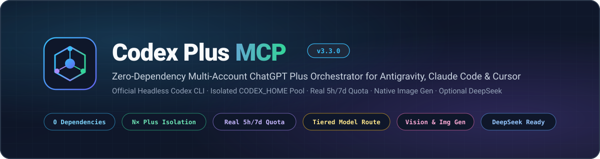
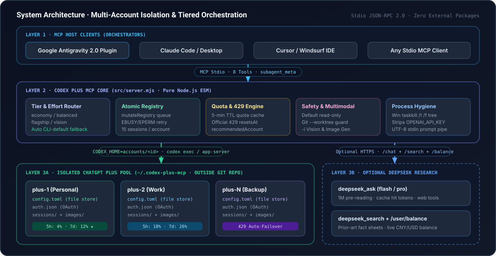
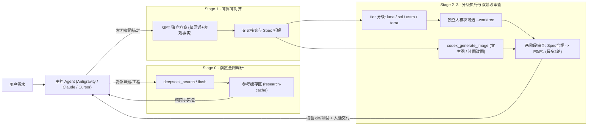

<div align="center">

<picture>
  <source media="(prefers-color-scheme: dark)" srcset="./assets/hero-dark.svg">
  <source media="(prefers-color-scheme: light)" srcset="./assets/hero-light.svg">
  
</picture>

<br/>

[](https://github.com/Mcdull581/codex-plus-mcp)
[](https://nodejs.org/)
[](#)
[](#)
[](LICENSE)

<p>
  <strong>将多个官方 ChatGPT Plus 订阅账号封装为零依赖、隔离无串号的 MCP 严谨子 Agent 池</strong><br/>
  <sub>原生无头 Codex CLI · 真实 5h/7d 额度监测 · 分级路由 · 读图与原生生图改图 · Git Worktree · 可选 DeepSeek 调研</sub>
</p>

<p>
  <a href="#为什么选择-codex-plus-mcp对比一览">方案对比</a> ·
  <a href="#系统架构与编排工作流">架构图</a> ·
  <a href="#快速开始交互式安装与账号授权">快速开始</a> ·
  <a href="#8-个内置-mcp-工具">工具参考</a> ·
  <a href="#模型分级路由">分级路由</a> ·
  <a href="#隐私与安全保障">安全机制</a>
</p>

</div>

---

## 为什么选择 Codex Plus MCP？（对比一览）

在 Antigravity、Claude Code、Cursor 等主控 Agent 中接入 GPT 时，传统方式各有硬伤。下表直观对比 4 种常见方案：

| 对比维度 | 原生手敲 `codex exec` | OpenAI API Key MCP | 网页爬虫桥接 (`webgpt2mcp`) | **Codex Plus MCP（本项目）** |
| :--- | :---: | :---: | :---: | :---: |
| **复用 Plus 订阅（0 额外 API 费）** | ✅ 单号 | ❌ 按 Token 另付高额 API 费 | ⚠️ 依赖网页 Cookie | ✅ **N 个 Plus 账号池，自动剥离 `OPENAI_API_KEY`** |
| **多账号并发隔离（零串号）** | ❌ 共用 `~/.codex` 互盖 | — | ❌ 易冲突 | ✅ **独立 `CODEX_HOME` + 文件凭证存储** |
| **真实 5h / 7d 官方额度 & 429 精准冷却** | ❌ 需手动进交互模式 `/status` | ❌ 仅计费账单 | ❌ 盲猜 | ✅ **`codex app-server` 实时拉取 + 5min TTL 缓存 + 官方 `resetsAt`** |
| **突破主控终端无网沙箱限制** | ❌ 每次联网命令需审批 | ✅ Stdio MCP | ⚠️ 依赖常驻浏览器 | ✅ **纯 Stdio MCP，配置一次永久无感直连** |
| **模型分级路由 + 不支持自动回退** | ❌ 每次手写 `-m` / `-c` | ⚠️ 固定模型 | ❌ 受限于前端 DOM | ✅ **`economy / balanced / flagship / vision` + 自动回退 CLI 默认** |
| **读图 & 原生 GPT 文生图/改图** | ⚠️ 易踩 `-i` 吞 `-` 坑 | 💰 生图单独按张计费 | ⚠️ DOM 极易失效 | ✅ **修复 `-i ... -- -` + 原生 `--enable image_generation`（0 额外费）** |
| **多轮长对话 & 防 429 跨号串话** | ❌ 手动记 UUID `session_id` | ⚠️ 状态难跨端 | ❌ 依赖网页 Tab | ✅ **每号自动追踪 15 条命名线程，429 自动提示摘要交接** |
| **安全写入隔离（单写原则 + Worktree）** | ⚠️ 默认权限过宽 | ❌ 无本地文件能力 | ❌ 无本地能力 | ✅ **默认 `read-only`；Git 仓库支持 `--worktree` 隔离写盘** |
| **Windows 健壮性（进程树 / BOM / 并发）** | ⚠️ 易留孤儿进程 / 引号转义坑 | ✅ | ❌ 经常弹窗/风控 | ✅ **`taskkill /t /f` + UTF-8 stdin + `mutateRegistry` 原子重试** |
| **安装体验（账号录入 + OAuth 授权）** | ❌ 全手工改 `config.toml` | 手填 Key | 手动维护 Profile | ✅ **`npm run setup` 5 步交互式向导，10 秒上线** |

> **典型收益**：
> - **零额外依赖、零额外 API 费**：纯 Node.js（>= 20）内置模块实现，直接复用已有的 1~N 个 ChatGPT Plus 订阅；
> - **智能省额提速**：5 分钟额度 TTL 缓存省去重复 RPC 探测（提速 1~2s/轮），`codex_list_accounts` 自动推荐余量最足的账号（`recommendedAccount`），并可选接 **DeepSeek Flash** 做低成本全网调研与文档预消化，把宝贵的 Plus 额度留给科研推导、核心算法与代码终审。

---

## 系统架构与编排工作流

### 1. 系统分层架构

<p align="center">
  
</p>

### 2. 多模型 5 阶段协同流（内置于 Antigravity 2.0 规则模板）



---

## 快速开始（交互式安装与账号授权）

### 前置要求
- **Node.js >= 20**（项目本身 **0 第三方 npm 依赖**，无需 `npm install`）
- **OpenAI Codex CLI**：
  ```bash
  npm install -g @openai/codex
  ```
- 至少 1 个 **ChatGPT Plus / Pro / Team** 官方订阅账号

### 一步启动交互式安装与授权向导

```bash
git clone https://github.com/Mcdull581/codex-plus-mcp.git
cd codex-plus-mcp
npm run setup
```

> 也可以直接运行对应平台的一键脚本：
> - **Windows PowerShell**：`powershell -ExecutionPolicy Bypass -File .\scripts\install-antigravity.ps1`
> - **macOS / Linux**：`bash ./scripts/install-antigravity.sh`

### 安装向导会自动带你完成 5 步

| 步骤 | 向导执行内容 | 说明 |
| :---: | :--- | :--- |
| **1/5** | **环境检测 & 独立目录部署** | 默认部署至 `~/.codex-plus-mcp`（与 Git 仓库物理隔离，彻底杜绝误提交密钥） |
| **2/5** | **交互式账号数据录入** | 自由设置 1~10 个账号槽位，逐个录入 `ID`（如 `plus-1`）、备注标签（如 `personal` / `work`）与可选默认模型 |
| **3/5** | **逐个官方 OAuth 浏览器授权** | 自动隔离 `CODEX_HOME` 并清掉 `OPENAI_API_KEY`，逐号拉起 `codex login` 完成授权（多账号时支持无痕窗口切换、失败重试或跳过补登） |
| **4/5** | **可选配置 DeepSeek API Key** | 默认可跳过；填入后写入本地 `~/.codex-plus-mcp/deepseek.json` 并自动探测 `/user/balance` 余额 |
| **5/5** | **一键接入客户端 & 协议自检** | 可选自动安装为 **Antigravity 2.0 原生 Plugin**（含 MCP + Skill + Rule），同时输出通用 `mcpServers` JSON，最后运行全套协议自检 |

> **随时补登或刷新单个账号**：
> ```bash
> node ~/.codex-plus-mcp/scripts/setup.mjs --login plus-2
> ```

---

## 8 个内置 MCP 工具

| 工具名 | 分类 | 核心能力 | 关键参数 |
| :--- | :--- | :--- | :--- |
| `codex_list_accounts` | 账号与额度 | 按余量推荐排序输出 `recommendedAccount`、各号 5h/7d 额度快照、近期命名会话与 DeepSeek 余额 | `check_live_status`, `include_live_quota` |
| `codex_manage_account` | 账号与额度 | 修改备注标签、设置默认模型、清除冷却标记或动态新增账号槽位 | `action`, `account`, `value` |
| `codex_exec` | GPT 子 Agent | 无头启动新任务（默认 `read-only` 单写安全），支持分级路由、传图与独立 `--worktree` | `account`, `prompt`, `topic`, `working_dir`, `sandbox`, `worktree`, `images`, `tier`, `model`, `reasoning_effort` |
| `codex_resume` | GPT 子 Agent | 在同账号既有长对话中继续追问以命中 Prompt Cache（自动识别最近 `sessionId`） | `account`, `prompt`, `session_id`, `images`, `tier`, `reasoning_effort` |
| `codex_review` | 代码与方案审查 | 严格只读「两阶段分级审查」（阶段一 Spec 合规 + 阶段二 P0 阻断 / P1 建议，防过度吹毛求疵） | `account`, `working_dir`, `focus`, `tier`, `reasoning_effort` |
| `codex_generate_image` | 原生生图/改图 | 启用 Codex CLI 原生 `--enable image_generation`（0 额外 API 费），支持文生图、参考图编辑、透明底与自定义保存路径，自动刷新真实 Plus 额度 | `account`, `prompt`, `output_path`, `reference_images`, `size`, `quality`, `transparent_background` |
| `deepseek_ask` | 可选 DeepSeek | 调用 `deepseek-flash`（1M 低成本预读）或 `deepseek-v4-pro`（深度推理），支持思考模式与服务端联网，返回精确 Token 与 `/user/balance` 余额 | `prompt`, `tier`, `thinking`, `web_search`, `system_prompt` |
| `deepseek_search` | 可选 DeepSeek | 优先调用 `/v1/tools/search`（不可用时自动降级 `deepseek-flash` 联网），输出精简带出处事实清单 | `query`, `ori_question`, `count`, `need_content`, `summarize` |

---

## 模型分级路由

支持在 `~/.codex-plus-mcp/accounts.json` 顶层的 `modelTiers` 自定义任意模型映射：

| `tier` 档位 | 默认模型 | 默认推理深度 | 推荐场景 |
| :--- | :--- | :--- | :--- |
| `economy` | `gpt-6-luna` | `medium` | 结构化抽取、日志解析、轻量初筛 |
| `balanced` | `gpt-6.2-sol` | `high` | 日常模块编码、重构、常规代码审查（性价比甜点） |
| `flagship` | `gpt-6.2-astra` | `high`（高危升 `xhigh`） | 科研证明、数学建模核心、复杂架构与疑难 Debug |
| `vision` | `gpt-6.1-terra` | `high` | 配合 `images` 传图核验论文图表、公式与界面截图 |

> **安全回退保障**：如果所选 `tier` 的模型 slug 暂不被当前账号支持，服务端会自动剥离 `-m` 回退到 Codex CLI 默认模型重试一次，并在 `subagent_meta` 中标记 `modelFallback: true`，确保绝不因模型名变更卡死。

---

## 进阶配置与示例

<details>
<summary><strong>1. Claude Code / Cursor / Windsurf 等通用 MCP 客户端配置</strong></summary>

在你的 MCP 客户端配置文件中加入（路径替换为 `npm run setup` 输出的实际绝对路径）：

```json
{
  "mcpServers": {
    "codex-plus": {
      "command": "node",
      "args": ["/path/to/home/.codex-plus-mcp/server.mjs"],
      "env": {
        "CODEX_BRIDGE_HOME": "/path/to/home/.codex-plus-mcp"
      }
    }
  }
}
```

如需通过环境变量提供 DeepSeek 密钥，可在 `env` 中追加 `"DEEPSEEK_API_KEY": "sk-..."`。

</details>

<details>
<summary><strong>2. 原生 GPT 文生图与读图改图示例（<code>codex_generate_image</code>）</strong></summary>

- **文生图并保存到指定路径**：
  ```json
  {
    "account": "plus-1",
    "prompt": "Clean Nature-style academic schematic of a dual-agent verification pipeline, crisp vector aesthetic, white background",
    "output_path": "/path/to/project/figures/pipeline.png",
    "size": "1536x1024",
    "quality": "high"
  }
  ```
- **先读图再改图（Image-to-Image）**：
  ```json
  {
    "account": "plus-1",
    "reference_images": ["/path/to/project/figures/draft.png"],
    "prompt": "保留整体架构布局，将配色调整为蓝灰学术科研配色，放大节点字号并优化箭头对齐",
    "output_path": "/path/to/project/figures/final.png"
  }
  ```

> 每次生图约消耗 3–5× 普通轮次额度，工具会在生成结束后自动强制刷新一次官方 Plus 5h/7d 实时额度并写入 `subagent_meta`。

</details>

<details>
<summary><strong>3. 离线/CI 非交互安装参数</strong></summary>

`scripts/setup.mjs` 支持自动化参数，便于脚本化部署或二次集成：

```bash
node scripts/setup.mjs \
  --non-interactive \
  --target ~/.codex-plus-mcp \
  --accounts '[{"id":"plus-1","label":"Personal"},{"id":"plus-2","label":"Work"}]' \
  --skip-auth
```

</details>

---

## 隐私与安全保障

1. **运行时数据与源码物理隔离**：所有 `auth.json`、`accounts.json`、`deepseek.json`、会话日志与生成图片默认存放在仓库外的 `~/.codex-plus-mcp/`，从根源避免 `git add .` 泄露个人凭据。
2. **严格 `.gitignore` 兜底**：已屏蔽 `accounts/`、`accounts.json`、`auth.json`、`deepseek.json`、`.env` 等所有敏感路径。
3. **强制走 Plus 订阅防误扣费**：拉起 Codex 子进程时自动清除 `OPENAI_API_KEY`，杜绝意外触发按量 API 账单。
4. **单写原则（Single-Writer）**：默认锁定 `--sandbox read-only`，仅在显式授权 `sandbox: "workspace-write"` 或 Git 仓库开启 `worktree: true` 时才允许写入。

---

## 测试验证

```bash
npm test
```

内置测试套件覆盖：MCP 协议握手、8 工具 Schema、余量推荐排序、5 路并发原子写 `mutateRegistry`、`images` / `worktree` / DeepSeek 守卫、Mock Codex CLI 端到端 `-i ... -- -` + `--enable image_generation` 拷贝与强制额度刷新、以及 `setup.mjs` 账号录入向导。

---

## License

[MIT](LICENSE)
