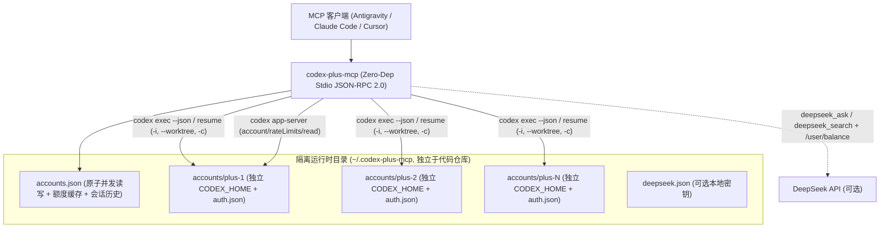

# Codex Plus MCP

[]()
[]()
[](LICENSE)

一个**零第三方依赖**、跨平台（Windows / macOS / Linux）的 **Model Context Protocol (MCP)** 服务端，让你在 **Google Antigravity / Claude Code / Cursor** 等任意 MCP 客户端中，把**多个官方 ChatGPT Plus 订阅账号**（通过官方无头 `@openai/codex` CLI）封装为可自主调度的严谨子 Agent，并可选集成 **DeepSeek API** 做低成本全网调研与文档预读。

---

## 核心特性

- **多 Plus 账号彻底隔离（零串号）**：为每个账号独立分配 `CODEX_HOME` 与 `cli_auth_credentials_store = "file"`，每个账号拥有独立的 `auth.json` 和会话目录，不污染系统默认 `~/.codex`；调用时自动清除 `OPENAI_API_KEY`，确保 100% 走 Plus 订阅额度而非 API 计费。
- **交互式安装与授权向导（`npm run setup`）**：安装过程中引导你逐个录入账号 ID、备注标签、可选默认模型，依次拉起官方浏览器完成 OAuth 授权，并支持可选录入 DeepSeek API Key 与一键接入 Antigravity 2.0 Plugin。
- **精准额度监测与智能荐号**：
  - 每次调用解析精确 Token 消耗（输入 / 缓存命中 / 输出）；
  - 通过官方 `codex app-server`（`account/rateLimits/read`）获取真实 **5 小时窗口 / 7 天周额度百分比与重置时间**（5 分钟 TTL 缓存提速，429 限流时自动采用官方真实 `resetsAt` 作为冷却截止时间）；
  - `codex_list_accounts` 按余量自动排序并输出 `recommendedAccount`。
- **模型分级路由 + 安全回退**：支持 `tier: "economy" | "balanced" | "flagship" | "vision"` 与 `reasoning_effort: "low" | "medium" | "high" | "xhigh"`；若账号不支持某个模型 slug，自动回退至 Codex CLI 默认模型重试并标记 `modelFallback: true`。
- **工程与科研增强**：支持本地图片附件（`-i` 传图核验论文图表/公式/截图）、独立 Git `--worktree` 隔离写入、多会话自动追踪（每号保留最近 15 条命名线程，无需用户记忆 `session_id`）、Windows 完整进程树清理与原子并发安全写盘。
- **可选 DeepSeek 扩展（统一用量与余额汇报）**：配置 `DEEPSEEK_API_KEY` 或本地 `deepseek.json` 后解锁 `deepseek_ask`（`deepseek-flash` / `deepseek-v4-pro` + 可选联网搜索）与 `deepseek_search`，同样汇报精确 Token 与 `/user/balance` 真实余额；不配置不影响任何 GPT/Codex 功能。

---

## 架构概览



---

## 快速开始

### 1. 前置要求
- **Node.js >= 20**（零额外 `npm install` 依赖）
- **OpenAI Codex CLI**：
  ```bash
  npm install -g @openai/codex
  ```
- 至少 1 个 **ChatGPT Plus / Pro / Team** 官方订阅账号

### 2. 克隆仓库并运行交互式安装与授权向导

```bash
git clone https://github.com/Mcdull581/codex-plus-mcp.git
cd codex-plus-mcp
```

运行安装向导（三选一）：

- **通用命令（Windows / macOS / Linux）**：
  ```bash
  npm run setup
  ```
- **Windows PowerShell**：
  ```powershell
  powershell -ExecutionPolicy Bypass -File .\scripts\install-antigravity.ps1
  ```
- **macOS / Linux**：
  ```bash
  bash ./scripts/install-antigravity.sh
  ```

### 3. 安装向导会带你完成以下 5 步
1. **选择独立数据目录**：默认为 `~/.codex-plus-mcp`（完全独立于 Git 仓库，防止误提交敏感凭据）。
2. **录入账号数据**：输入要配置的 ChatGPT Plus 账号数量（支持 1~10 个），依次填写账号 ID（如 `plus-1`）、备注标签（如 `personal` / `work`）与可选默认模型。
3. **逐个完成官方 OAuth 授权**：依次为未登录账号隔离 `CODEX_HOME` 并拉起 `codex login` 完成浏览器授权（登录第 2 个及以上账号时请切换浏览器账号或使用无痕窗口）。
4. **可选配置 DeepSeek API Key**：跳过则只用 GPT/Codex；填入后会自动写入本地 `~/.codex-plus-mcp/deepseek.json` 并校验 `/user/balance` 余额。
5. **客户端接入与自检**：一键部署为 **Antigravity 2.0 原生 Plugin**（含 MCP + Skill + Rule），同时输出标准 `mcpServers` JSON 供 Claude Code / Cursor / Windsurf 复制，最后自动运行协议自检。

### 4. 后续随时补登 / 刷新单个账号授权
```bash
node ~/.codex-plus-mcp/scripts/setup.mjs --login plus-2
```

---

## 通用 MCP 客户端手动配置（非 Antigravity）

如果你使用 Claude Code、Cursor、Windsurf 或其他支持 Stdio 的 MCP 客户端，只需在客户端的 MCP 配置文件中添加：

```json
{
  "mcpServers": {
    "codex-plus": {
      "command": "node",
      "args": ["/path/to/home/.codex-plus-mcp/server.mjs"],
      "env": {
        "CODEX_BRIDGE_HOME": "/path/to/home/.codex-plus-mcp"
      }
    }
  }
}
```

> 可选：如需通过环境变量提供 DeepSeek 密钥，可在 `env` 中增加 `"DEEPSEEK_API_KEY": "sk-..."`（或直接保存在 `~/.codex-plus-mcp/deepseek.json`）。

---

## 暴露的 MCP 工具一览

| 工具名 | 作用 | 关键参数 |
| :--- | :--- | :--- |
| `codex_list_accounts` | 列出所有账号状态、额度快照、`recommendedAccount` 推荐排序、近期命名会话与 DeepSeek 余额 | `check_live_status`, `include_live_quota` |
| `codex_manage_account` | 修改账号备注、设置默认模型、清除冷却标记或新增账号槽位 | `action`, `account`, `value` |
| `codex_exec` | 启动新的无头 GPT 子 Agent 会话（默认只读 `read-only`） | `account`, `prompt`, `topic`, `working_dir`, `sandbox`, `worktree`, `images`, `tier`, `model`, `reasoning_effort` |
| `codex_resume` | 在同账号的既有长对话中继续追问（命中 Prompt Cache） | `account`, `prompt`, `session_id`, `images`, `tier`, `reasoning_effort` |
| `codex_review` | 严格只读的两阶段分级审查（Spec 合规 + P0 阻断 / P1 建议） | `account`, `working_dir`, `focus`, `tier`, `reasoning_effort` |
| `deepseek_ask` | 调用 DeepSeek（`flash` / `pro` + 可选思考与服务端联网）并返回 Token 与实时余额 | `prompt`, `tier`, `thinking`, `web_search` |
| `deepseek_search` | 调用 DeepSeek 搜索（优先 `/v1/tools/search`，自动降级 `deepseek-flash` 联网）输出带出处事实清单 | `query`, `ori_question`, `count`, `summarize` |

---

## 模型分级路由（默认映射）

可在 `~/.codex-plus-mcp/accounts.json` 顶层的 `modelTiers` 字段自定义覆盖：

| `tier` 档位 | 默认模型 | 默认推理深度 | 典型场景 |
| :--- | :--- | :--- | :--- |
| `economy` | `gpt-6-luna` | `medium` | 结构化抽取、日志解析、轻量初筛 |
| `balanced` | `gpt-6.2-sol` | `high` | 日常代码实现、常规审查 |
| `flagship` | `gpt-6.2-astra` | `high`（高危升 `xhigh`） | 科研证明、数学建模核心、复杂架构/疑难 Debug |
| `vision` | `gpt-6.1-terra` | `high` | 配合 `images` 传图核验图表/公式/截图 |

> 若所选 `tier` 对应的模型 slug 当前账号暂不支持，服务端会自动去掉 `-m` 回退到 Codex CLI 默认模型重试，不会中断任务。

---

## 隐私与安全说明

1. **凭据与代码彻底分离**：默认数据目录在用户主目录 `~/.codex-plus-mcp/`，所有 OAuth 凭据（`auth.json`）、本地账号表（`accounts.json`）与可选 `deepseek.json` 均不会写入本仓库目录。
2. **`.gitignore` 强制兜底**：已忽略 `accounts/`、`accounts.json`、`auth.json`、`deepseek.json`、`.env` 等所有敏感文件，防止误提交。
3. **默认单写原则**：`codex_exec` 默认以 `--sandbox read-only` 运行，只有显式传 `sandbox: "workspace-write"` 或在 Git 仓库中开启 `worktree: true` 时才允许写入。

---

## 运行测试

```bash
npm test
```

## License

[MIT](LICENSE)
